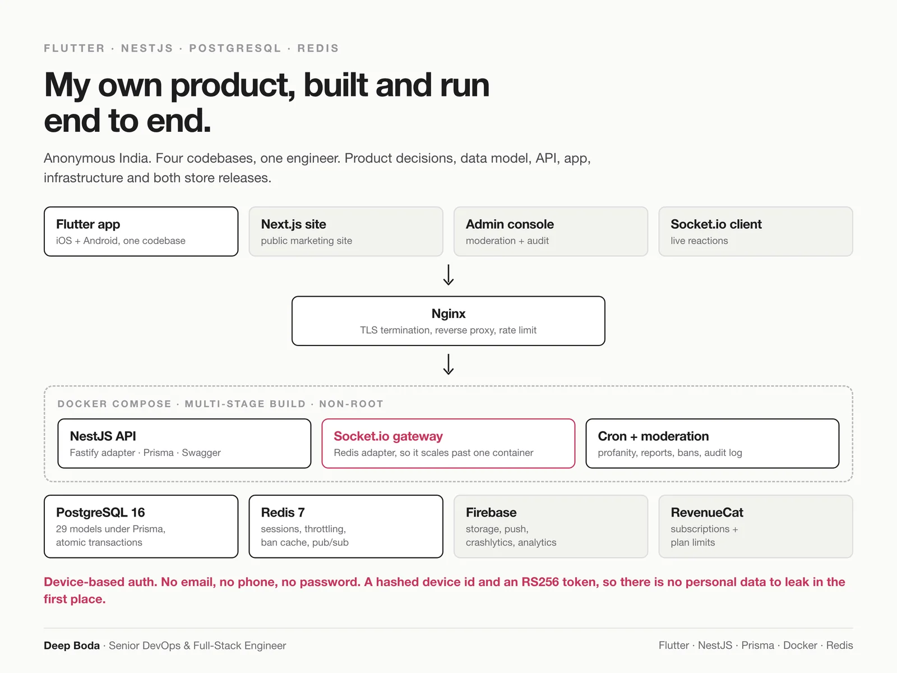

<picture>
  <source media="(prefers-color-scheme: dark)" srcset="assets/banner-dark.svg">
  
</picture>

  
  
  
  

Four and a half years running production at a services company. Kubernetes on AWS EKS serving millions of requests a day, ECS microservices behind a platform with 100,000+ users, Terraform for all of it, and the Node.js services running on top. I also take the apps through signing and into the App Store, Play Store and macOS.

**I build it, ship it, and keep it running.**

 

## What I run

| Layer | What I do there | Tools |
|---|---|---|
| **Edge** | DNS, certificates, caching rules set on purpose | Route 53 · CloudFront · ACM · Nginx |
| **Cluster** | EKS clusters, ECS services, autoscaling from measured peaks | Kubernetes · ECS · Helm · HPA · Cluster Autoscaler |
| **Delivery** | GitOps, so a bad release is one reverted commit | ArgoCD · Jenkins · GitHub Actions · CircleCI · CodePipeline |
| **Infrastructure as code** | Every environment defined, nothing clicked | Terraform · Docker · ECR |
| **Observability** | Alerts that mean someone has to act | Prometheus · Grafana · CloudWatch |
| **Data** | Replicas, connection pools, caching, search | PostgreSQL · MySQL · Redis · Elasticsearch |
| **Application** | APIs, realtime, admin dashboards | Node.js · NestJS · Express · Socket.io · Next.js · React |
| **Release** | Signed builds, staged rollouts, store accounts | App Store Connect · Play Console · TestFlight · notarisation |

  
  
  
  
  
  
  
  
  
  
  
  
   
  
  
  
  
  
  
  
  
  
  
  
  

## Platforms I have run

Client and company names are left out on purpose. The engineering is mine to talk about, the names are not.

| Platform | Scale | My part | Stack |
|---|---|---|---|
| **Consumer travel platform** | Millions of requests a day | Infrastructure lead | EKS · ArgoCD · Jenkins · Elasticsearch · Redis · CloudFront |
| **Fintech trading platform** | 100,000+ users, live market data | Infrastructure lead | ECS · SQS · Lambda · Socket.io · Redis · MySQL |
| **AI tools directory** | Owned end to end | Backend and infrastructure lead | Node.js · Elasticsearch · OpenAI API · CloudFront |
| **Digital business card platform** | Cards linked to NFC products | Backend lead | Node.js · PostgreSQL · Redis · Stripe · CircleCI |
| **Enterprise ERP** | Back office for a large industrial group | Backend lead | Node.js · PostgreSQL · Azure Pipelines · Azure Blob Storage |

Architecture diagrams and the decisions behind each one: **[deepboda.in/work](https://deepboda.in/work)**

## My own product: Anonymous India

Four codebases, one engineer. Product decisions, data model, API, app, infrastructure and both store releases.

- **API:** NestJS on the Fastify adapter, Prisma over PostgreSQL 16, Redis 7 for sessions, throttling and the Socket.io adapter, so realtime keeps working past one container.
- **Auth:** device based. A hashed device id and an RS256 token, no email, phone or password, so there is no personal data to leak.
- **Moderation:** profanity filter, reports, bans, an audit log and per-user rate limits, all on the server.
- **Infra:** multi-stage Docker build running as non-root, Compose with Postgres, Redis, the API and Nginx.

Full case study: **[deepboda.in/work/anonymous-india](https://deepboda.in/work/anonymous-india)**

## Writing

Notes from running production. Mostly about the gaps between layers, because that is where the expensive problems live.

- [Ten API calls. Three of them were the same question.](https://deepboda.in/writing/three-lakh-api-calls)
- [The night one service took everything with it](https://deepboda.in/writing/one-service-took-everything)
- [You don't have backups. You have files.](https://deepboda.in/writing/restore-time)
- [Do you actually need Kubernetes?](https://deepboda.in/writing/kubernetes-ladder)

More at **[deepboda.in/writing](https://deepboda.in/writing)**

 

Nobody notices infrastructure when it works. I made peace with that a long time ago.

**Open to Senior DevOps, Platform and SRE roles** · [deepboda18@gmail.com](mailto:deepboda18@gmail.com) · [deepboda.in](https://deepboda.in)

